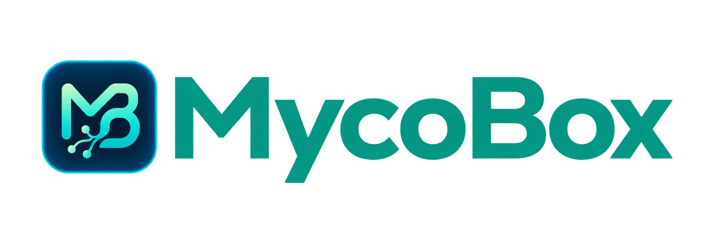
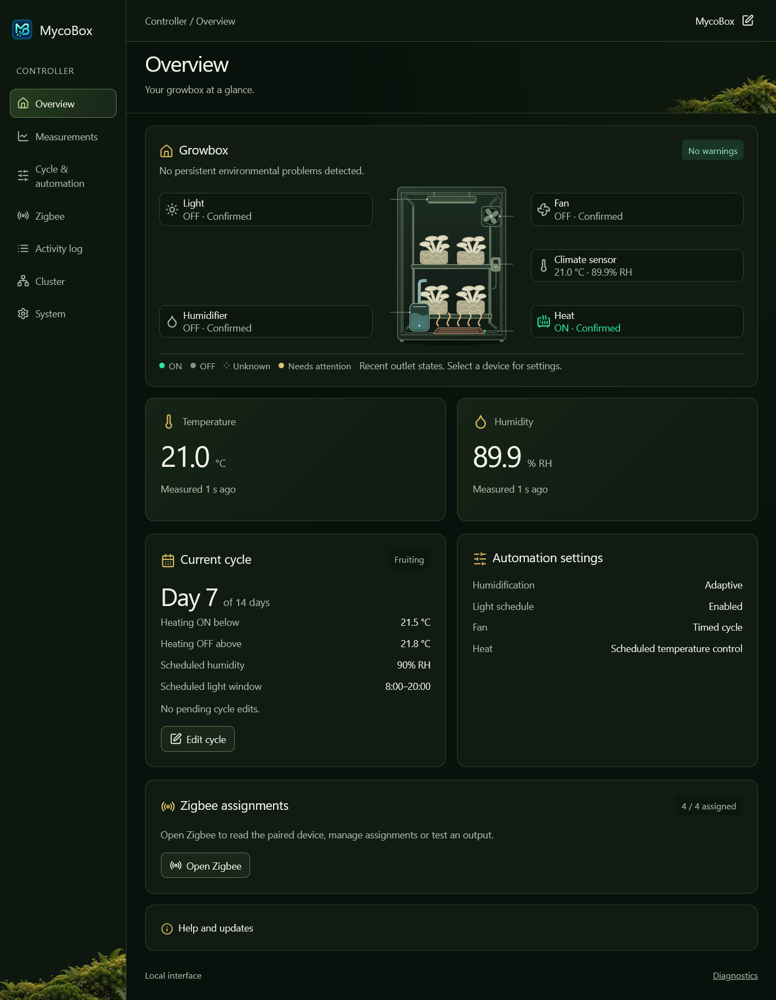
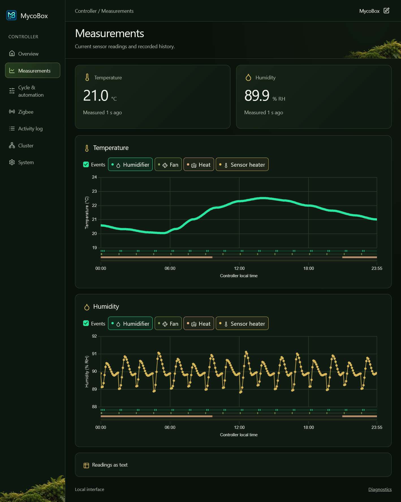
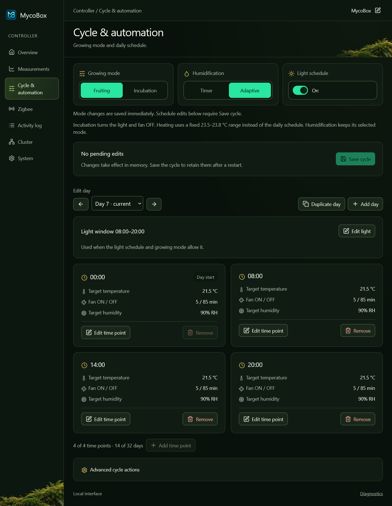
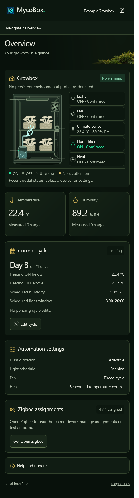

  

**Local climate automation for your growing space.**

Monitor temperature and humidity, follow your growing cycle and control humidification, ventilation, heating and lighting from one local interface. MycoBox runs on the controller, with access from a phone or computer.

[Getting started](docs/getting-started.md) · [Firmware releases](https://github.com/Moffefe/MycoBox/releases) · [Compatibility](docs/compatibility.md)

## Your growbox at a glance

  

Overview combines a Growbox visualization with current temperature and humidity, measurement freshness, the active cycle and equipment assignments. See the confirmed state of **Humidifier**, **Fan**, **Light** and **Heat** in one place.

Local warnings highlight persistent environmental deviations. The panel also shows when current conditions cannot be assessed.

## Measurements and activity

  

The **Sensirion SHT41** measures temperature and relative humidity. Charts place these readings alongside activity tracks for **Humidifier**, **Fan**, **Heat** and **Sensor heater**, making environmental changes easier to follow.

The panel holds up to **288 samples at five-minute intervals**, approximately 24 hours of continuous operation. History is kept in memory and starts again after a restart. Activity tracks show confirmed output states and commands rather than physical measurements of equipment operation.

## Cycle and automation

  

Build a cycle of up to **32 days**, with up to **four time points per day**. Use the same settings throughout or change targets as the cycle progresses.

| Function | Control |
| --- | --- |
| Humidification | Scheduled ON/OFF periods in Timer mode, or adaptive pulses guided by humidity readings and target |
| Fan | Configurable ON and OFF periods |
| Heat | Temperature control using the active schedule |
| Light | A daily light window |
| Incubation | Fan and light set to OFF, fixed heating thresholds, selected humidification mode retained |

Schedule changes take effect in memory. Use **Save cycle** to keep them after a restart.

## Zigbee equipment

  

Pair **one compatible Zigbee outlet or power strip** and assign a different output to each function: **Humidifier**, **Fan**, **Light** and **Heat**.

MycoBox detects the available ON/OFF outputs and supports up to 32 detected outputs. Check compatibility and independent switching with your actual device before automatic operation.

[Zigbee setup](docs/zigbee.md) · [Compatibility](docs/compatibility.md)

## Activity log

Follow equipment events with readable descriptions and action hints. Sort the loaded entries by time, event or message, and open **Technical details** when more diagnostic information is needed.

## Local control on phones and computers

  

The web interface and its assets are stored on MycoBox. Normal control works without a cloud account or a permanently connected computer. Connect through your local Wi-Fi network or the controller's access point.

A working, initialized hardware RTC keeps local time available without internet. NTP synchronization is optional. Basic status is also available on the controller's display.

## Firmware updates

  

Update the **ESP32-S3 Main Controller** from **System → Main Controller firmware** and the **ESP32-H2 Zigbee Controller** from the **Zigbee** page.

S3 OTA preserves saved settings. After an H2 update, pair the Zigbee device again, save its assignments and test each output. Follow the release notes to select compatible firmware.

[Download firmware](https://github.com/Moffefe/MycoBox/releases) · [Update instructions](docs/firmware-update.md)

## Documentation

- [Getting started](docs/getting-started.md)
- [Hardware overview](docs/hardware-overview.md)
- [Compatibility](docs/compatibility.md)
- [Zigbee setup](docs/zigbee.md)
- [Firmware updates](docs/firmware-update.md)
- [Troubleshooting](docs/troubleshooting.md)
- [Roadmap](docs/roadmap.md)
- [Safety](docs/safety.md)
- [Security policy](SECURITY.md)

Use connected equipment within its electrical ratings and verify every output before unattended operation. Local warnings help with monitoring; they do not replace equipment safety protections.

