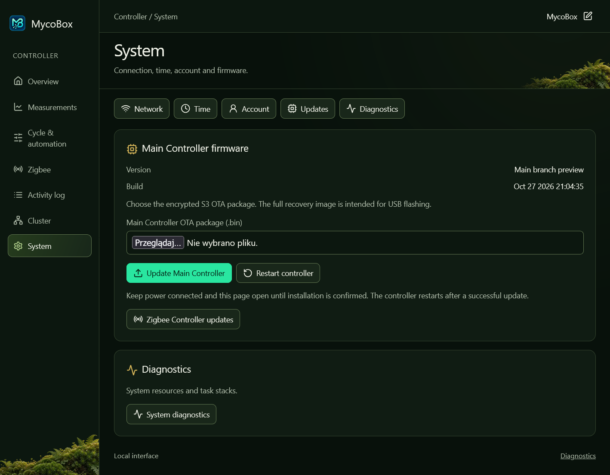
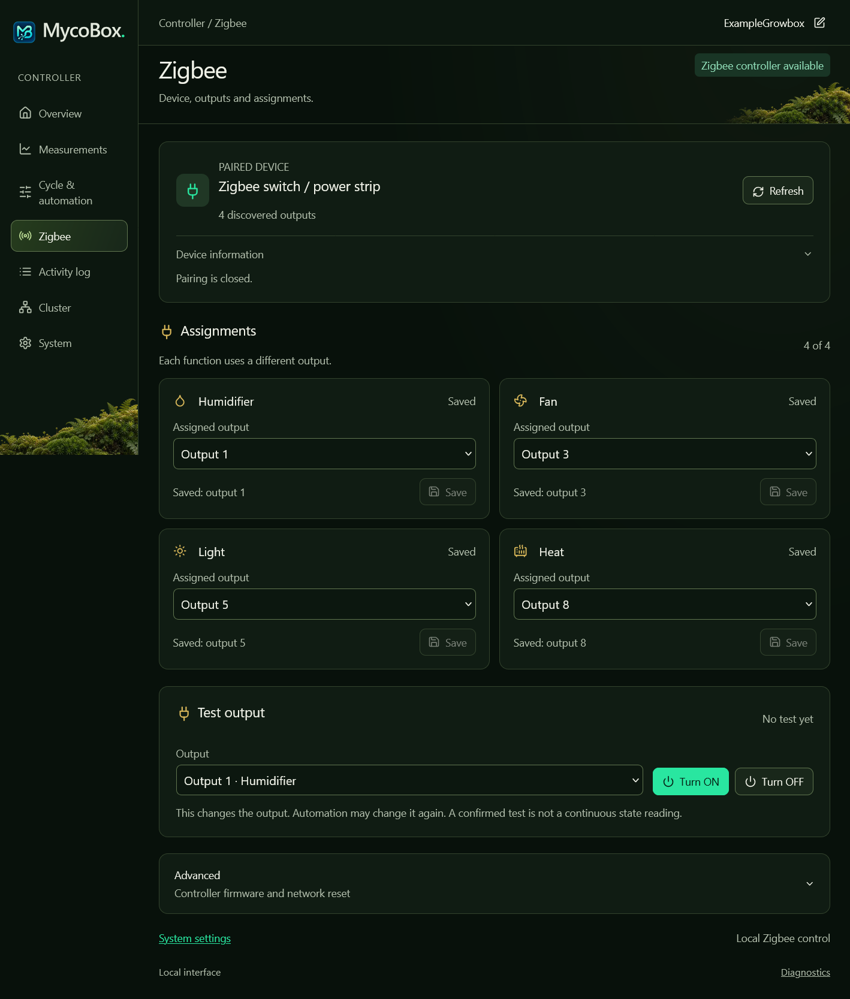

# Firmware Updates

MycoBox has two controllers: **Main Controller (S3)** and **Zigbee Controller (H2)**. Each uses its own update file.

## Before updating

1. Open [Releases](https://github.com/Moffefe/MycoBox/releases) and read the instructions for the version you want to install.
2. Save pending cycle edits and [download a settings backup](backup-restore.md#export-settings).
3. Keep MycoBox powered, stay nearby and leave the update page open until it finishes.

<a id="updating-both-controllers"></a>

When updating both controllers, install **S3 first, then H2**. This is the order for [v1.666.EN](https://github.com/Moffefe/MycoBox/releases/tag/v1.666.EN), which introduces the current H2 update package. Update only the controllers listed in the release instructions.

## Firmware files

Download the files from [official MycoBox Releases](https://github.com/Moffefe/MycoBox/releases).

| File | Choose it for |
| --- | --- |
| `MycoBox-S3-OTA-vX.XXX.EN.bin` | Main Controller update in the web panel |
| `MycoBox-H2-OTA-vX.XXX.EN.bin` | Zigbee Controller update in the web panel |
| `MycoBox-H2-vX.XXX.EN.bin` in older releases | The older full-image procedure described in that release |
| `SHA256SUMS.txt` | Checking that a download is complete and unchanged |

For the current web panel, choose the **OTA** file for the correct controller. Full recovery images use a separate service procedure.

### Firmware file integrity

To check a download, compare its SHA-256 value with the entry in **SHA256SUMS.txt**. In PowerShell, replace the filename below with yours:

```powershell
Get-FileHash -Algorithm SHA256 '.\MycoBox-S3-OTA-v1.666.EN.bin'
```

If the values differ, download the file again.

## What happens to settings?

| Update or recovery | What happens |
| --- | --- |
| Main Controller web update | Saved settings, pairing and output assignments stay in place. Save cycle edits before updating. |
| Current Zigbee Controller OTA update | Pairing and output assignments stay in place. |
| Older full-image H2 update or full H2 recovery | Pair the switch again, then restore and check its assignments. |
| Full S3 recovery over USB | Set up the Main Controller again. |

Follow any special migration instructions in the release notes. Before installing an older version, check that it can use your current settings.

<a id="pair-zigbee-devices-again"></a>

After recovery, a [settings backup](backup-restore.md) helps restore configuration. If pairing was cleared, [pair the switch and restore its assignments](zigbee.md#restoring-assignments-after-maintenance) first.

## Version verification

You can find the installed versions here:

| Controller | Where to look |
| --- | --- |
| Main Controller | **System → Main Controller firmware → Version / Build** |
| Zigbee Controller | **Zigbee → Advanced → Firmware / Build** |

Check these again after updating.

## Updating the Main Controller

Open **System → Main Controller firmware**, or use the **Updates** shortcut.



1. In **Main Controller OTA package (.bin)**, select the **S3-OTA** file.
2. Choose **Update Main Controller** and confirm.
3. Wait for installation to finish. Reaching 100% upload is one step; keep power connected while MycoBox checks and installs the file.
4. Wait for the automatic restart, then reconnect if needed.
5. Check the new version, saved settings, fresh readings and [equipment operation](safety.md#before-leaving-the-system-unattended).

### If the Main Controller update fails

If the panel still opens, read the error, check the file and its checksum, then try again with a stable connection.

For **Update result unknown**, reconnect and check the installed version before uploading again. If MycoBox no longer starts normally, follow [Recovery firmware](#recovery-firmware).

## Updating the Zigbee Controller

Open **Zigbee → Advanced → Zigbee Controller · ESP32-H2**, or use **Zigbee Controller updates** in System.



### H2 update procedure

1. Install the required S3 update first. Keep the paired plug or strip powered.
2. In **Zigbee Controller OTA package (.bin)**, select the **H2-OTA** file.
3. Choose **Update Zigbee Controller** and confirm. MycoBox turns the affected outputs OFF before installing.
4. Wait for the upload, restart and final checks. Automation resumes when those checks finish.
5. Check the new version, assignments and [equipment operation](safety.md#before-leaving-the-system-unattended).

Until the update finishes, MycoBox pauses automation, ON commands, assignment changes, pairing and network reset. Restarting the Main Controller keeps this pause in place.

If a separate network reset had already cleared assignments, [restore them](zigbee.md#restoring-assignments-after-maintenance) after the update.

### If an H2 update is interrupted

Reconnect, open **Zigbee** and read the update status.

- **Waiting for the switch or output checks:** keep the original plug or strip powered and within range, then allow verification to finish.
- **Upload interrupted:** when the updater allows a retry, upload the complete matching **H2-OTA** file again.
- **Retry blocked or H2 still unavailable:** use [service recovery](#recovery-firmware).

An interrupted H2 installation cannot return to its previous firmware automatically. Keep the saved settings and network intact while resolving it; resetting them will not complete the update.

## Recovery firmware

Recovery is for a controller that cannot be restored through its normal update page. Contact the maintainer with your controller model, last known versions and the error shown.

Use the recovery procedure provided for your device. Afterwards, follow [initial setup](getting-started.md), [settings restore](backup-restore.md#import-selected-settings) and [Zigbee restore](zigbee.md#restoring-assignments-after-maintenance) as needed. The [table above](#what-happens-to-settings) shows what each recovery replaces.

<a id="related-documentation"></a>

[Documentation](README.md) · [Troubleshooting](troubleshooting.md) · [Safety](safety.md)
