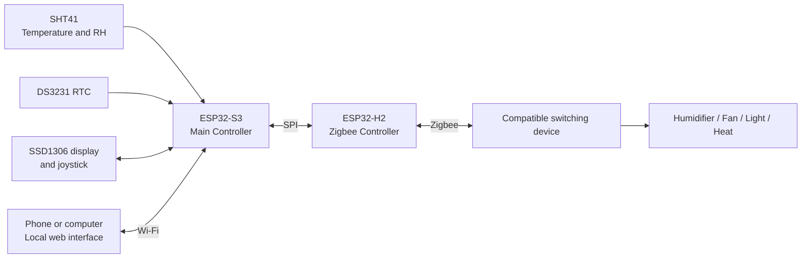

# Hardware Overview

[MycoBox home](../README.md) · [Documentation](README.md) · [Getting started](getting-started.md)

MycoBox separates environmental automation on an **ESP32-S3 Main Controller** from Zigbee communication on an **ESP32-H2 Zigbee Controller**. Normal operation runs locally.

## System architecture

These are functional connections, not a wiring plan. Board wiring, power supplies and module connections must match the intended controller hardware.

## ESP32-S3 Main Controller

The S3 reads the environmental sensor, runs automation and schedules, stores configuration and maintains measurement/event histories. It provides Wi-Fi and the local web interface, drives the display and joystick, and manages firmware updates.

Mains-powered loads connect to the external switching device, rather than directly to S3 GPIOs.

## ESP32-H2 Zigbee Controller

The H2 is the Zigbee coordinator. It discovers switching outputs, sends commands and returns output-state confirmations to the S3 over SPI. Both controllers and the paired device must remain operational for output control.

## Environmental sensors

The SHT41 connects to the S3 over I²C and supplies temperature and relative humidity. Its built-in sensor heater is separate from the **Heat** output used for enclosure heating.

See [Compatibility](compatibility.md#environmental-sensors) for supported sensor hardware, [Web interface](web-interface.md#sensor-heating-and-cooling) for measurement states and [Safety](safety.md#sensor-placement) for placement.

## Real-time clock

The DS3231 supplies time without internet when connected and initialized with a valid time. NTP can synchronize it when a time server is reachable. See [time setup](getting-started.md#7-configure-time-and-localization) for timezone and clock configuration.

## Local user interface

The SSD1306 128 × 32 display and joystick provide basic status, network information and local controls. Detailed configuration uses a browser.

## Wi-Fi and web interface

The S3 stores and serves the interface and its assets. Wi-Fi connects a phone or computer for access; a permanently connected computer, cloud account and internet connection are not required for normal automation.

[Getting started](getting-started.md) covers first connection and network recovery. [Web interface](web-interface.md) describes the screens and controls; the [security policy](../SECURITY.md) describes network protection.

## Zigbee actuators

The external outlet or strip provides switched power for the four equipment roles. Supported device classes, output limits and tested models are listed in [Compatibility](compatibility.md#zigbee-actuator-compatibility); setup belongs in [Zigbee](zigbee.md).

## Example installations

| Installation | Example use |
| --- | --- |
| Indoor growing enclosure | Temperature/RH monitoring with light, ventilation and humidification; heating where needed |
| Mushroom fruiting chamber | Humidification and timed ventilation alongside scheduled light and heating |
| Terrarium or vivarium | The available measurements and switching roles configured for the enclosure's requirements |

An installation may use only some roles. These examples do not establish suitability for a particular species or environment; see [Safety](safety.md#suitable-applications).

## Control path

A measurement or schedule determines a role's requested state. Its saved assignment selects an output; the S3 requests the change through H2 and checks the output confirmation. This confirmation describes the switching output, while the equipment and environmental response need physical observation.

## Maintenance references

Use [Firmware updates](firmware-update.md) for the separate S3/H2 packages and recovery, [Zigbee](zigbee.md) for assignments and network maintenance, and [Safety](safety.md) before servicing connected equipment.
