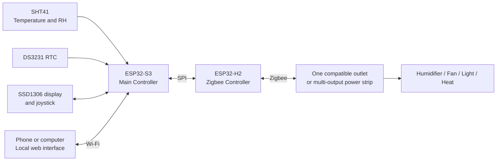

# Hardware Overview

[MycoBox home](../README.md) · [Documentation](README.md) · [Getting Started](getting-started.md)

MycoBox uses an **ESP32-S3 Main Controller** for measurements and automation, and an **ESP32-H2 Zigbee Controller** to communicate with one compatible switching device. The web interface and normal control run locally.

## System architecture

The diagram shows functional connections. It is not a wiring plan or a list of interchangeable modules.

## ESP32-S3 Main Controller

The Main Controller:

- reads temperature and RH from the SHT41;
- runs heating, humidification, fan timing and light schedules;
- stores the account, network, time, cycle and output assignments;
- provides Wi-Fi and the local web interface;
- maintains measurement and activity histories in memory;
- drives the local display and handles joystick input;
- manages firmware updates and communicates with the Zigbee Controller.

Mains-powered equipment is switched by the external Zigbee device, rather than connected directly to the ESP32-S3 GPIOs.

## ESP32-H2 Zigbee Controller

The ESP32-H2 acts as the Zigbee coordinator. It pairs one compatible switching device, discovers its ON/OFF outputs, sends switching commands and provides output confirmations to the Main Controller.

The controllers communicate internally over SPI. A Wi-Fi browser connection is not needed for ordinary control decisions, but the Zigbee device and both controllers must remain operational for output control.

## Environmental sensors

The current sensor is a **Sensirion SHT41**, connected directly to the Main Controller's I²C bus. It provides temperature and relative humidity; the current configuration has no CO₂ measurement or altitude setting.

Fresh ambient samples are taken every five seconds. The web interface shows freshness and distinguishes valid readings, sensor heating, cooling after heating and communication errors.

The sensor's heater is separate from the growbox's **Heat** output. During sensor heating and cooling, new ambient readings are paused. Heating control and Adaptive humidification depend on usable measurements; a displayed heater phase is not a reading of growbox heating activity.

Correct sensor installation, supply and placement matter, particularly with condensation and prolonged high humidity. Sensor-heater handling does not guarantee accuracy in every enclosure. See [Compatibility](compatibility.md#environmental-sensors).

## Real-time clock

The **DS3231** supplies an offline time source when it is connected and holds a valid time. MycoBox can also synchronize from NTP when a time server is reachable.

Set the timezone in **System → Time**. Local display time and daily automation schedules follow that timezone in both Automatic and Manual modes. Manual date/time entry uses UTC; the computer-time button performs that conversion.

Check the clock after a battery or power problem before relying on scheduled transitions.

## Local user interface

MycoBox supports an **SSD1306 128 × 32 display** and a joystick for basic local information and controls.

The **Network** screen shows the connection mode, IP address and discovery name. From the main display, move the joystick left to open it. Detailed schedules, output assignments and firmware updates are managed in the browser.

## Wi-Fi and web interface

The Main Controller serves its own page assets. A phone or computer on the same local network can open its IP address or, where mDNS is available, `http://<controller-name>.local`.

The main pages are **Overview**, **Measurements**, **Cycle & automation**, **Zigbee**, **Activity log**, **Cluster** and **System**. See the [Web interface guide](web-interface.md) for their controls.

The Growbox diagram represents fresh confirmed output states. It does not measure physical airflow, mist production or heat delivery. Local warnings indicate persistent environmental problems and are informational.

The panel uses HTTP and belongs on a trusted local network. Normal operation does not require a cloud account or a permanently connected computer.

## Zigbee actuators

Use **one compatible smart outlet or multi-output strip**. It must expose supported ON/OFF outputs; not every Zigbee plug, relay or switch implementation does so.

Each function uses a different output:

| Assignment | Connected equipment |
| --- | --- |
| Humidifier | Humidifier |
| Fan | Ventilation fan |
| Light | Light |
| Heat | Suitable heating equipment |

The device must have enough independent outputs for the roles you want to use. A single-outlet plug can provide one role; a compatible strip can provide several. Unused roles can remain unassigned.

Check the equipment's electrical ratings and whether it resumes the intended operation after its supply is switched. An output confirming ON does not prove that the connected appliance is operating correctly.

## Example installations

### Indoor growing enclosure

A setup may use the SHT41, a light, ventilation fan and humidifier. Add heating only when the environment requires it and the equipment is suitable. These roles must use separate compatible outputs on the paired switching device.

### Mushroom fruiting chamber

A fruiting chamber can use Humidifier, Fan, Light and Heat together with local temperature/RH monitoring. Fan timing is configured in the cycle; it is not controlled by a CO₂ sensor.

### Terrarium or vivarium

The same available temperature/RH inputs and switching roles can be configured for another enclosure. Select the conditions and equipment for that application; the hardware overview does not establish suitability for a particular species or use.

Not every installation needs every role.

## Multi-outlet Zigbee devices

The firmware discovers up to **32 ON/OFF outputs**, using actual endpoint numbers in **1–240**. Nonconsecutive numbering is allowed. The limit describes implementation support; individual models and larger output configurations need physical testing.

For example, a strip with four independently verified outputs can assign one each to Humidifier, Fan, Light and Heat. Printed outlet labels may not match the endpoint numbers shown in the panel.

Use **Zigbee → Test output** to identify ON and OFF behavior before saving assignments. Every role requires a different output. See [Zigbee Setup](zigbee.md) and [Compatibility](compatibility.md).

## Control path

A sensor reading or schedule determines a logical role's requested state. Its saved assignment selects an output on the paired Zigbee device. The Main Controller requests the change through the Zigbee Controller and checks for an output confirmation.

An assignment change, Zigbee network reset or H2 update requires affected outputs to confirm OFF. If confirmation fails, the operation can be refused. Check the device and its power/connection before retrying.

Confirmation concerns the switching output. The physical equipment and resulting growbox conditions still need observation.

## Network operation

MycoBox uses your Wi-Fi network for browser access and optional network services such as NTP. If the internet is unavailable, local automation can continue with the hardware and valid time it needs.

Without saved Wi-Fi settings, or after failed attempts to join the saved network, the controller starts `<controller-name>_AP`. Network recovery can take several minutes while saved-network attempts run. Use the actual IP on the local Network display.

See [Getting Started](getting-started.md#network-recovery) and [Troubleshooting](troubleshooting.md).

## Firmware components

| Controller | Update location | Important effect |
| --- | --- | --- |
| ESP32-S3 Main Controller | **System → Main Controller firmware** | The encrypted S3 OTA package preserves saved S3 settings. |
| ESP32-H2 Zigbee Controller | **Zigbee → Advanced** | The current H2 application OTA package preserves compatible pairing and assignments; automation waits for verification. |

Use compatible controller firmware as directed by the release notes, updating S3 first when introducing H2 application OTA. Full recovery images do not belong in the current web OTA forms. Full S3 recovery overwrites S3 settings; full H2 recovery replaces Zigbee data and requires pairing again.

See [Firmware Updates](firmware-update.md) before choosing a file or starting an update.

## Safety considerations

Respect the switching device's load ratings, protect electrical parts from water and condensation, and provide independent protection for heating where appropriate. Test outputs and observe a new or changed installation before unattended operation. MycoBox is not a certified safety system.

See [Safety](safety.md).

## Related documentation

[Getting Started](getting-started.md) · [Compatibility](compatibility.md) · [Web interface](web-interface.md) · [Zigbee Setup](zigbee.md) · [Firmware Updates](firmware-update.md) · [Troubleshooting](troubleshooting.md) · [Safety](safety.md)
