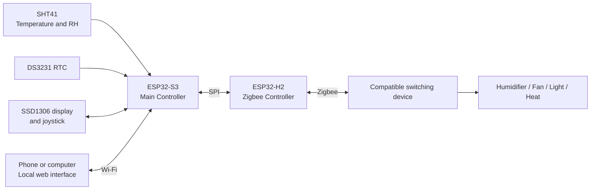

# Hardware Overview

[MycoBox home](../README.md) · [Documentation](README.md) · [Getting started](getting-started.md)

MycoBox uses a main controller to read conditions and run your schedule, plus a Zigbee controller to switch connected equipment.

## System architecture

The diagram shows how the parts work together. For wiring, use the instructions for your controller hardware.

## ESP32-S3 Main Controller

The Main Controller reads temperature and humidity, runs automation and stores your settings. It also provides Wi-Fi, the web panel, measurement history and the local display.

Connect appliances to the smart plug or strip, not directly to the controller.

## ESP32-H2 Zigbee Controller

The Zigbee Controller connects MycoBox to the paired plug or strip. It finds the available outputs, sends ON/OFF commands and checks their state.

## Environmental sensors

The **SHT41** measures temperature and humidity. Its small built-in heater helps manage the sensor during prolonged high humidity; it is separate from the **Heat** output for your enclosure.

See [supported sensors](compatibility.md#environmental-sensors), [sensor placement](safety.md#sensor-placement) and [heating/cooling messages](web-interface.md#sensor-heating-and-cooling).

## Real-time clock

The **DS3231** keeps time offline once the clock is set. MycoBox can also set it from a network time server. Follow [Clock setup](getting-started.md#7-configure-time-and-localization) to choose the time mode and timezone.

## Local user interface

The **SSD1306 display and joystick** show basic status and network information. Use the web panel for detailed settings.

## Wi-Fi and web interface

Connect a phone or computer through Wi-Fi to open the panel. MycoBox runs automation locally, so you can close the browser and disconnect your computer afterwards.

A cloud account or internet connection is not needed for normal operation. See [Getting started](getting-started.md) for connecting and [Security](../SECURITY.md) for protecting access.

## Zigbee actuators

A smart plug or strip supplies switched power to **Humidifier**, **Fan**, **Light** and **Heat**.

Choose hardware using [Compatibility](compatibility.md#zigbee-actuator-compatibility), then follow [Zigbee setup](zigbee.md) to test and assign its sockets.

## Example installations

| Installation | Example use |
| --- | --- |
| Indoor growing enclosure | Temperature, humidity, lighting and ventilation |
| Mushroom fruiting chamber | Humidification, timed ventilation, light and heating |
| Terrarium or vivarium | Monitoring and equipment control for the enclosure |

Use only the roles you need, with settings and equipment suited to what you grow or keep. See [Suitable applications](safety.md#suitable-applications).

## Control path

A reading or scheduled time tells MycoBox what to do. MycoBox sends the command to the assigned socket and checks its response. You can follow this in **Overview** and compare it with the appliance's effect in **Measurements**.

## Maintenance references

[Firmware updates](firmware-update.md) · [Zigbee setup](zigbee.md) · [Safety](safety.md)
